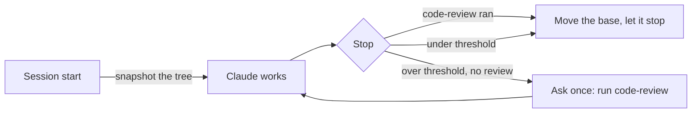

<h1 align="center">claude-starter</h1>

<p align="center">
  <em>Asks before it assumes. Reviews what it changed. Cleans up after itself.</em><br>
  <sub>A small Claude Code setup where every piece that changes Claude's behaviour had to survive a benchmark.</sub>
</p>

<p align="center">
  <a href="plugins/starter/.claude-plugin/plugin.json"></a>
  <a href="https://code.claude.com"></a>
  <a href="test/scripts.test.mjs"></a>
  
  <a href="LICENSE"></a>
</p>

<p align="center">
  <strong>Sonnet ran the review rule in 4 of 12 SWE sessions · with the review gate: 6 of 6 sessions over the threshold</strong><br>
  <strong>16 real bugs caught and fixed by the fan-out review across 3 runs · each one reproduced first</strong><br>
  <sub>Harbor runs on Claude Code 2.1.312, small samples, hidden tests. Read every number as a direction. <a href="#the-numbers">Details</a>.</sub>
</p>

```bash
claude plugin marketplace add bothuany/claude-starter
claude plugin install starter@claude-starter      # then, in a session: /starter:setup
```

---

Most Claude Code setups add a crowd of "senior engineer" agents and hope for the best. This one is a handful of pieces, each doing something the model doesn't do on its own. The pieces that change how Claude works were measured before they shipped. One that didn't earn its cost was cut. One that cost 2× for nothing on small plans was fenced in. This README tells you which.

## The numbers

Measured with the Harbor benchmark harness on Claude Code 2.1.312, headless (`claude -p`), with hidden tests. Samples are small; costs are Claude Code's API-equivalent `cost_usd`, not what a subscription bills.

| What we measured | Without | With the starter |
|---|---|---|
| Sonnet 5.5 runs `code-review` in SWE-bench Pro sessions | 4/8, then 0/4 (rule only) | **3/3, then 3/3** of sessions over the threshold (rule + review gate) |
| Opus 5.5 follows the scoped review rule (review when over the threshold, skip when under) | — | **12/12** decisions correct |
| Bugs the post-fan-out review confirmed and fixed, each reproduced and given a regression test | — | **16** across 3 runs (5, 5, 6) |
| Plan conflict found independently by all 3 runs and handed to the user | — | **3/3** |
| Fan-out on a plan of small parts (about 100–150 lines each) | $1.21, main session read 374k tokens | $2.28–2.50, main session read 976k–1,207k |

That last row is why fan-out is fenced in: on small parts it cost about **2× the money**, and the main session processed about **2.6× more input**, for the same result. Since 0.3 it only fans out when at least two parts are large; on that same small plan, the current wording kept it in one session 3/3 times.

## What's inside

| Piece | Kind | What it does |
|---|---|---|
| **Working rules** | A block in `~/.claude/CLAUDE.md` (about 500 tokens) | Short rules: ask before assuming, check the docs, route web research, delegate wide searches, fan out only big plans, verify before saying done ([read them](plugins/starter/rules.md)) |
| **Review gate** | `Stop` hook, on by default | If the session changed enough code and `code-review` hasn't run, it asks Claude once to run it before stopping |
| **`fan-out`** | Skill (Claude may pick it) | Runs an approved plan's large, independent parts as parallel Sonnet workers in their own git worktrees, merges them one at a time, then reviews the merged result once and checks it against the plan |
| **`implementer`** | Subagent (Sonnet, `isolation: worktree`) | One fan-out worker: builds its part inside the files it owns, commits on its own branch, reports in 10 lines |
| **`clean-worktrees`** | Skill (you run it) | Removes clean, merged worktrees and branches, and never deletes through links into your main checkout |
| **`setup`** | Skill (you run it) | Installs what a plugin can't ship, showing every change first |
| **`monthly-review`** | Skill plus a reminder when a review is due (at most once a day) | Runs `/insights`, checks its suggestions against your setup, applies at most two, prunes auto memory |

## Quick start

Needs **Node.js 18+** on PATH: the hooks and scripts run with `node`, and Claude Code's native installer doesn't include it. Without Node, the session-start hook shows an error each time.

```bash
claude plugin marketplace add bothuany/claude-starter
claude plugin install starter@claude-starter
```

Then, in a session, run `/starter:setup`. It shows each change and asks before making it:

- **Rules:** written into `~/.claude/CLAUDE.md` between markers, with a timestamped backup. Nothing else in the file changes. Skip them, and setup remembers.
- **`worktree.baseRef: "head"`:** set for the project you fan out in, so workers see the contract commit.
- **Optional add-ons** (all off unless you say yes): context7, obscura, i-have-adhd and ponytail. See [below](#optional-add-ons).
- **The review gate:** on by default; turn it off here if you prefer.

New rules take effect in the next session, and new MCP servers after a restart. After a plugin update that changes the rules, a one-line notice tells you to run setup again.

## Commands

| Command | What it does |
|---|---|
| `/starter:setup` | Show and apply the setup above. `/starter:setup check` only reports the current state |
| `/starter:fan-out <plan file or parts>` | Fan out an approved plan yourself, skipping the size check |
| `/starter:clean-worktrees` | List worktrees and branches, propose what's safe to remove, ask, then remove it. Add `all-merged` to skip the question, or `--into <branch>` to measure "merged" against another branch |
| `/starter:monthly-review` | Run the monthly review. `off` stops the reminder; `on` brings it back |
| `CLAUDE_STARTER_REVIEW_GATE=off` | Turn the review gate off from settings (`off`, `0`, `false` or `no`) |

To turn the gate off for every session, add this to `~/.claude/settings.json`:

```json
{ "env": { "CLAUDE_STARTER_REVIEW_GATE": "off" } }
```

## How it works

### The rules, in one breath

- **Ask before assuming.** If a request is ambiguous in a way that changes the result, ask, at most 4 questions with a recommended option first. Don't ask what you can look up.
- **Check the docs, not memory.** Look up a third-party API before writing against it (context7, or the official docs), and say which version you checked.
- **Web research.** Use obscura first when it's connected; fall back to WebSearch and WebFetch, and say so.
- **Delegate wide searches** to a subagent that returns conclusions, not file dumps. Fan out only big plans. Read a worker's diff; don't trust its summary.
- **Verify before you say done.** Run the project's tests, type check and lint, and report failures word for word. Call `code-review` for larger changes and handle every finding with evidence. Say plainly what wasn't verified.

### Review that runs when it matters, and findings that need evidence

The rules ask for `code-review` when a change crosses a size threshold. Opus follows that. Sonnet, in long sessions, often doesn't: once it named "credential handling" as the reason the rule applied, then skipped the review anyway. So the threshold is also enforced by a hook:



- **When it fires:** 2+ non-test files with 15+ changed lines in total, or more than 50 non-test lines, since the last review. Committed changes count too.
- **What doesn't count:**
  - tests (`test/`, `tests/`, `__tests__/`, `spec/`, `testdata/`, `fixtures/`, `*.test.*`, `*.spec.*`, `*_test.go`, `test_*.py`);
  - docs (`docs/`, `.md`, `.rst`, `.txt` and similar);
  - anything under `.claude/`.
- **What counts as a review:** Claude calling `code-review`, or you typing `/code-review`. Other review commands, such as `/ponytail-review`, don't.
- **It asks once per change set.** After a review, or a one-line answer such as "docs only" or "not my change", the base moves forward, so follow-up fixes don't trigger another round.
- **It ignores what isn't the session's work:** pulls, merges, resets, checkouts to another commit, and turns with no file-changing tool call. Creating a branch doesn't count, so Claude's own work is still asked about after it branches.
- **It costs little and fails silent.** It adds no context unless it blocks, it keeps its own git index and never touches yours, and any error lets Claude stop.

Finding a bug isn't enough; acting on it matters. On one SWE-bench Pro task (vuls), all 8 earlier failures broke on the same filename-parsing edge case. Replayed offline, `code-review` named that exact case in **4 of 8** diffs. Under the gate, one run fixed it and passed, the first pass in 9 trials. In the next run, the review named the bug word for word, and the agent dismissed it because "the cases in the task ... parse correctly". Since 0.5.0, every finding gets one of three outcomes (a wording change; its effect isn't measured yet):

- **Confirmed:** reproduce it with a command or a throwaway test, then fix it.
- **Dismissed:** only with evidence, meaning the line you read or a command you ran and its output.
- **Unverified:** only when checking takes more than a few minutes or needs your decision.

"The examples pass" and "it was like that before" don't count as evidence.

### Fan-out, only when it pays

Before deciding, Claude writes a scope line in its reply:

```
Scope: 4 qualifying parts; estimated non-test lines per part: 140, 120, 150, 110; large parts: 0 -> main session
```

It fans out only with **3+ independent parts that share no files, at least 2 of them large** (more than about 200 non-test lines, or 3+ non-test files). Typing `/starter:fan-out` yourself skips that decision. When it does fan out:

1. **You approve the split.** Claude shows a table of parts, the files each owns and the shared contract, and settles open design questions first, because workers can't ask you.
2. **It checks the preconditions.** It commits the shared contract. If workers would branch from the remote instead of your HEAD (`worktree.baseRef` isn't `"head"`), it stops and offers to fix that for this project.
3. **Workers build.** Up to 5 Sonnet workers run in parallel worktrees, and the rest queue.
4. **It merges one part at a time,** reading each diff and running the fast checks after each merge.
5. **One review at high effort** runs on the merged result. Each finding gets the evidence treatment above.
6. **It checks the result against the plan** with a table: every plan item, the `file:line` that implements it, and the test that covers it.
7. **It cleans up** the merged workers' worktrees and branches with the safe cleanup below. It leaves unmerged ones in place, and never pushes or opens a PR unless you ask.

### Cleanup that never deletes through a link

Worktrees often hold symlinks, or NTFS junctions on Windows, into the main checkout's `node_modules`. Git for Windows deletes through a junction on `git worktree remove --force`. `clean-worktrees` unlinks every link first (the link, never its target), and refuses a worktree that:

- has uncommitted or untracked files;
- has a git status it can't read;
- is detached with commits that no branch holds;
- is locked by a running session, unless you force it;
- holds gitignored files, unless you allow it after seeing the list;
- is in use by another program (checked on Windows);
- is your main checkout.

"Merged" means merged into your local default branch (from `origin/HEAD`, then `main`, then `master`), so unpushed merges count. If none is found, it asks instead of guessing.

## What you'll see at session start

The starter never adds context at session start. When something needs you, it shows one line that only you see:

| Notice | Why | What to do |
|---|---|---|
| `the working rules are not installed` / `changed in a plugin update` | The rules block is missing, or a newer version is out | Run `/starter:setup`, or skip the rules there to silence this |
| `the claude-starter markers in your CLAUDE.md are unbalanced` | A begin or end marker was edited away | Delete the old block by hand; setup won't guess where it ends |
| `monthly review due` | Your newest `/insights` report is 30+ days old, or a memory index passed 150 lines or 20KB | Run `/starter:monthly-review`, or `off` to stop it. It shows at most once a day |

## Optional add-ons

All four are offered by `/starter:setup`, and none is installed without a yes.

| Add-on | What it brings | What it costs |
|---|---|---|
| [**context7**](https://github.com/upstash/context7) | Current library documentation as an MCP server, no key needed | Tool schemas, loaded on demand. Sends library names and topics to context7.com, so check that's allowed on a work machine |
| [**obscura**](https://github.com/h4ckf0r0day/obscura) | A local headless browser for web research, used before WebSearch/WebFetch | Install the binary yourself: the normal build from its releases page, not a `-stealth` build, on PATH. Then run setup |
| [**i-have-adhd**](https://github.com/ayghri/i-have-adhd) | A separate third-party plugin (MIT, pinned to v0.4.1) that shapes answers: next action first, numbered steps, no tangents | A SessionStart hook adds its instructions to every session |
| [**ponytail**](https://github.com/DietrichGebert/ponytail) | A separate third-party plugin (MIT, pinned to v5.3.3), "the laziest senior dev in the room": reuse what the repo has, standard library first, the smallest code that works, never cutting validation, security or tests. Adds `/ponytail-review`, `/ponytail-audit` and a cost band above the prompt | Its instructions load into every session through its own hooks. After each turn it writes a row (cost, tokens, tests) to `~/.config/ponytail/band/` on your machine; nothing leaves unless you set its webhook |

You can install the two third-party plugins directly, too: `claude plugin install i-have-adhd@claude-starter` or `claude plugin install ponytail@claude-starter`. Their claims and numbers are their authors', not measured here.

## The evidence

<details>
<summary><b>Rules vs no rules</b>: Opus 5.5, 4 small Node tasks × 3</summary>

| | No rules | Rules (0.2.0) |
|---|---|---|
| Success | 9/12 | 9/12 |
| `code-review` called | 0/12 | 12/12 |
| Edits made after the review | — | 0/12 |
| Cost per task | $0.13 | $0.25 |
| Agent time | 29 s | 52 s |

All misses came from one task, where both arms fixed the asked bug but missed a second, unasked contract bug. These were ceiling tasks: "no edits after review" doesn't show the review is useless, only that it was costly on small changes. That is why 0.4 scoped the rule. With the scoped rule on the same tasks, Opus made 12/12 correct decisions: 9 reviews and 3 skips.
</details>

<details>
<summary><b>Fan-out vs one session</b>: Opus main session, Sonnet workers, 4-part plan × 3</summary>

| Arm (0.2.0) | Success | Cost | Agent time | Peak main context | Main-session input |
|---|---|---|---|---|---|
| One session | 3/3 (44/44 tests) | $1.21 | 289 s | 52k | 374k |
| Auto fan-out | 3/3 | $2.50 | 283 s | 62k | 1,207k |
| `/starter:fan-out` | 3/3 | $2.28 | 252 s | 58k | 976k |

Under 0.4, on the same plan:

- **Plain instruction:** it stayed in one session 3/3, at $1.14–1.16.
- **Forced with `/starter:fan-out`:** it fanned out 3/3 with 4 workers, at $2.14–2.66.

The review after the merge found 5, 5 and 6 bugs, each reproduced and given a regression test:

- a stack overflow at 200,000 rows;
- semver prerelease numbers above 2^53 comparing equal;
- float rounding at exact halves;
- inherited object properties read as columns.

It dismissed 1–2 per run with evidence, and handed the same spec conflict to the user in all 3 runs. The hidden-test score didn't move, because the hidden tests don't cover those edges.
</details>

<details>
<summary><b>Review gate</b>: Sonnet 5.5 on SWE-bench Pro (vuls, teleport, element-web, openlibrary), k = 1</summary>

| Run | Review ran when over the threshold | Solved | Cost (4 tasks) |
|---|---|---|---|
| Baseline, no starter | — | 1/4, 2/4 | $0.72, $0.82 |
| Rules (± plugin), no gate | 4/8, 0/4 | 1/4 per arm | $0.87–0.96 (first round) |
| Gate, first run | 3/3 | 3/4 | $1.12 |
| Gate, after fixes | 3/3 | 2/4 | $1.13 |

The gate reliably gets the review to run, at about +29% cost ($1.12 vs $0.87). With k = 1, the solved column is noise: the baseline alone moved from 1/4 to 2/4. Don't read it as a success-rate gain. openlibrary stayed under the threshold, so the gate never blocked there. On Opus small tasks the gate never had to fire, and no review ran twice.
</details>

### Not measured yet

- **Ask-first behaviour interactively.** Headless runs can't ask. In one manual check, with the rules Claude asked 2 questions before coding; without them it coded at once.
- **Fan-out on a genuinely large plan:** whether it still fans out there, and whether it pays.
- **The 0.5.0 evidence rule's effect** on acting on findings.
- **The review's catch rate** on seeded defects, and `low` vs `medium`.

## Context cost

| | Tokens in every session |
|---|---|
| Rules in CLAUDE.md | about 500 |
| What Claude sees of the plugin (`fan-out` and `implementer` descriptions) | about 250 |
| Hooks (session check, review gate) | 0, until the gate blocks |
| `setup`, `clean-worktrees`, `monthly-review` | 0 (user-only skills) |

`claude plugin details starter` reports about 540 always-on tokens, but that also counts the three user-only skills, whose descriptions don't load. Add-ons bring their own: context7's tool schemas load on demand, and i-have-adhd and ponytail add their instructions to every session.

## Design choices

- **Few pieces, each one earning its place.** No generic coder, architect or reviewer agents: they add context at every session and little behaviour. A separate reviewer agent was built, tried and dropped. `code-review` already runs in its own forked context, so the wrapper added a layer without a fresher view.
- **Rules in CLAUDE.md, hooks only where rules fail.** You can read and edit the rules, and their cost is fixed. The review gate exists because one model skipped the rule; nothing else is forced.
- **Questions come from the main session.** Subagents can't ask you, so open questions are settled before delegating.
- **Parallel only when it pays.** Coding parallelizes less than research. On small parts fan-out cost 2×, so it's fenced in. The 200-line mark is a guess: only the low end is measured.

## Limits to know

- **Rules are probabilistic.** That's why the review has a hook. For any other rule you need guaranteed, use a hook in that project.
- **Claude's own merges count as outside changes.** A merge, pull, reset or rebase moves the gate's base even when Claude ran it. Fan-out reviews its own merges anyway.
- **Gate cost on big repos.** Each check runs `git add -A` into a private index, so very large untracked files or Git LFS clean filters slow it down. Turn it off with `/starter:setup` or the env setting above.
- **Worker dependencies.** A worktree is a fresh checkout. Before spawning workers, fan-out decides how they get dependencies: `.worktreeinclude`, `worktree.symlinkDirectories`, a cheap install, or checks that need none.
- **`worktree.baseRef: "head"`** also makes `claude --worktree` sessions start from your current HEAD. That's why setup sets it per project.

## Keep it sharp: the monthly review

The starter never writes skills or memories on its own: tools that do tend to pile up near-duplicates. Instead, `/starter:monthly-review`:

1. **Gets an `/insights` report.** It reuses one from the last 7 days. Otherwise it runs a new one, which took about a minute and about $1.50 for 130 sessions in our runs. If that fails, it asks you to run `/insights` yourself.
2. **Checks every suggestion** against the skills, hooks and CLAUDE.md files you already have. Each one is already covered, wrong for your setup, or worth doing.
3. **Applies at most two,** after you choose, so you can tell whether each one helped. A CLAUDE.md line goes where it's needed, a skill goes through `skill-creator` with a before-and-after eval, and a hook goes into the project.
4. **Prunes auto memory.** It proposes removing what's stale, duplicated or derivable from the code, and asks before deleting anything.

Claude Code deletes `/insights` reports after `cleanupPeriodDays` (30 by default), so "no recent report" is normal. Raise that setting if you want reviews to reach further back.

## FAQ

**Will it slow me down?**
Small changes: no. Below the threshold the review isn't asked for, and the hooks add no context. Larger changes get one review, which cost about +29% on our SWE runs.

**Can I use only part of it?**
Yes. Skip the rules in setup, turn the gate off, or never type the commands. Each piece works on its own.

**Does it work with Sonnet?**
Yes. That's why the gate exists: Opus followed the review rule on its own, while Sonnet needed the nudge.

**Why does fan-out so rarely run?**
Because on the plans we could measure, it cost 2× for the same result. It's for plans with large parts. If you want it anyway, type `/starter:fan-out`.

## Privacy

- The starter itself collects nothing and sends nothing.
- context7, if you add it, sends library names and topics to [context7.com](https://context7.com).
- ponytail, if you add it, keeps its task log on your machine unless you set its webhook.
- obscura runs locally.

## Uninstall

```bash
claude plugin uninstall starter@claude-starter
```

Then undo what setup wrote, if you want it gone. If you use `CLAUDE_CONFIG_DIR`, read that folder for `~/.claude` below.

- Delete the block between `claude-starter:begin` and `claude-starter:end` in `~/.claude/CLAUDE.md`.
- Remove `worktree.baseRef` from the project's `.claude/settings.local.json` or from `~/.claude/settings.json`.
- If setup added them, run `claude mcp remove --scope user obscura` and `claude mcp remove --scope user context7`.
- If you added them, run `claude plugin uninstall i-have-adhd@claude-starter` and `claude plugin uninstall ponytail@claude-starter`.
- Delete the `*.starter-backup` files.

## Tests

```bash
node --test test/scripts.test.mjs
```

Runs every script against throwaway repositories and config directories; it never touches your own `~/.claude`.

## Pairs well with

- [`feature-dev`](https://github.com/anthropics/claude-plugins-official): a guided explore → clarify → architect → build → review flow for larger features.
- [superpowers](https://github.com/obra/superpowers): a much more prescriptive workflow. "Verify before claiming done" comes from it.

## License

MIT
