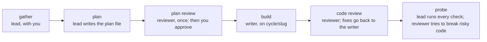

# claude-starter

A small Claude Code setup. It asks before it assumes, reviews risky changes, and gives a piece of work a named cycle: a plan file, a clean-context build, and reviews that start fresh.

[](plugins/starter/.claude-plugin/plugin.json) [](LICENSE)

```bash
claude plugin marketplace add bothuany/claude-starter
claude plugin install starter@claude-starter
```

Works from your next session. Nothing is written to your `CLAUDE.md`. Needs Node.js 18+.

## The cycle

The cycle is off by default. You start it for one piece of work with `/starter:cycle <work>`; questions and small fixes never enter it. The session you talk to, the lead, moves the work through six phases and hands off through a plan file, `docs/plans/<slug>.md`, so the build and the reviews start in a clean context instead of the lead's long one.



- **The plan file is the contract.** It holds the decisions and a list of items, each with a check, a command that passes when the item is done. The writer ticks an item only after its check passes. The lead re-reads the file at every phase, so a new session can resume with `/starter:cycle`.
- **Roles are named, never forks.** `writer` (Sonnet, high effort) builds from the plan file. `reviewer` (Opus, medium) reviews the plan, then the code against the plan and `REVIEW.md`. `reader` (Sonnet, medium) does wide reading. A fork would inherit the lead's whole context, which is what the cycle avoids.
- **Work stays on a branch.** The lead creates `cycle/<slug>` and commits there after each phase; nothing is pushed or merged unless you ask.

## Always on

Two things work in every session, with no cycle started:

- **The rules**, about 450 words injected at session start: ask before assuming, check the docs, route web research, delegate wide reading to `reader`, and verify before saying done. A failing test or command comes before a bug fix, every review finding needs evidence, and after three review rounds on one change the lead asks you whether the approach is right. [Read them](plugins/starter/rules.md).
- **The review gate**, a `Stop` hook. If the session changed enough code and no review ran, it asks for one, once. When the change is not risky (no network, permissions or stored data), Claude says so in one line and stops.

## What's inside

| Piece | What it does |
|---|---|
| Working rules | The always-on rules above |
| Review gate | The `Stop` hook above |
| `/starter:cycle` | `/starter:cycle <work>` starts a cycle and writes its plan file; with no argument it resumes the open one; `off` stops it |
| Role agents | `reader` (Sonnet, medium) reads and reports, `writer` (Sonnet, high) changes files, `reviewer` (Opus, medium) checks a plan or a change with a fresh context. Each role fixes its model and effort |
| `/phase` | Opens a side pane: `/phase` shows the cycle's phase, the running agent and the plan's finished items |
| `visual-plan` | Writes a plan in the plan-file format first; an optional visual page of it shows diagrams, the API contract, the data model, items with their checks and open questions |
| `/starter:grill` | Interviews you about a loose idea, two question cards at a time, until every choice is made |
| `/starter:review-setup` | Reads your repo and drafts a short `REVIEW.md`: what failure looks like here, what is risky, what to skip |
| `/starter:clean-worktrees` | Removes clean, merged worktrees and branches, never through a symlink into your checkout |
| `/starter:monthly-review` | Checks `/insights` against your setup, applies at most two changes, prunes stale memory |
| `/starter:setup` | Optional add-ons (context7, obscura, i-have-adhd, ponytail) and turning the rules or the gate off, each shown first. The plugin also reminds you, once a day per project, that it has no `REVIEW.md` or hasn't run claude-code-setup, until you run them or `skip review-md` / `skip project-setup` |

## Turn things off

- **The cycle:** type nothing. It only runs when you start it, and `/starter:cycle off` stops the open one.
- **The rules and the review gate:** run `/starter:setup`, or drop the gate in `~/.claude/settings.json`:

```json
{ "env": { "CLAUDE_STARTER_REVIEW_GATE": "off" } }
```

---

[Details and evidence](docs/DETAILS.md) · [The rules, verbatim](plugins/starter/rules.md) · Tests: `node --test test/scripts.test.mjs` and `claude plugin test plugins/starter` · MIT
