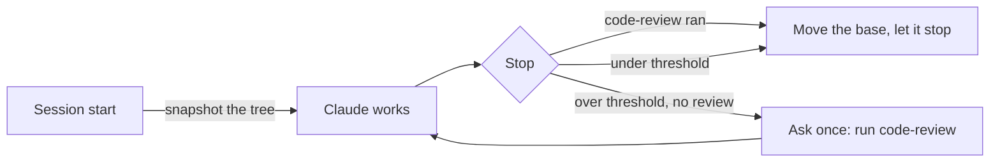

# claude-starter

**A small, measured Claude Code setup: it asks before it assumes, reviews what it changed, and cleans up after itself.**

[](plugins/starter/.claude-plugin/plugin.json)
[](https://code.claude.com)
[](test/scripts.test.mjs)
[](LICENSE)

Most Claude Code setups add generic "senior engineer" agents and hope for the best. This one is a handful of pieces, each doing something the model doesn't do by default, and the ones that change how Claude works (the rules, the review gate, fan-out) were run through a benchmark harness before they shipped. Where a piece didn't earn its cost, it got cut or fenced in, and this README says so.

## The numbers

Measured with the Harbor benchmark harness on Claude Code 2.1.312, headless (`claude -p`), with hidden tests. The samples are small, so read every number as a direction, not an effect size. Costs are Claude Code's API-equivalent `cost_usd`, not what a subscription bills.

| What we measured | Without | With the starter |
|---|---|---|
| Sonnet 5.5 runs `code-review` on large SWE-bench Pro changes | 4/8, then 0/4 (rule only) | **3/3, then 3/3** (rule + review gate) |
| Opus 5.5 follows the scoped review rule (review when over the threshold, skip when under) | — | **12/12** decisions correct |
| Bugs the post-fan-out review confirmed and fixed, each reproduced and given a regression test | — | **16** across 3 runs (5, 5, 6) |
| Plan conflict found independently by all 3 runs and handed to the user | — | **3/3** |
| Fan-out on a plan of small parts (about 100–150 lines each) | $1.21, main session read 374k tokens | $2.28–2.50, main session read 976k–1,207k |

That last row is why fan-out is fenced in: on small parts it cost about **2× the money** and the main session processed about **2.6× more input**, for the same result. Since 0.3 it only fans out when at least two parts are large; on that same small plan, the current wording kept it in one session 3/3 times.

## What's inside

| Piece | Kind | What it does |
|---|---|---|
| **Working rules** | A block in `~/.claude/CLAUDE.md` (about 500 tokens) | Ask before assuming; check the docs, not memory; delegate wide searches; fan out only big plans; review larger changes and handle every finding with evidence |
| **Review gate** | `Stop` hook, on by default | When the session changed 2+ non-test files (15+ lines) or more than 50 non-test lines and `code-review` hasn't run, it asks Claude once to run it before stopping |
| **`fan-out`** | Skill (Claude may pick it) | Runs an approved plan's large, independent parts as parallel Sonnet workers in their own git worktrees, merges them one at a time, then reviews the merged result once and checks it against the plan |
| **`implementer`** | Subagent (Sonnet, `isolation: worktree`) | Builds one part inside the files it owns, commits, and reports in 10 lines |
| **`clean-worktrees`** | Skill (you run it) | Removes clean, merged worktrees and branches, and never deletes through links into your main checkout |
| **`setup`** | Skill (you run it) | Installs the pieces a plugin can't ship, after showing exactly what will change |
| **`monthly-review`** | Skill plus a once-a-day reminder | Runs `/insights`, checks its suggestions against your setup, applies at most two, and prunes auto memory |

Optional: [context7](https://github.com/upstash/context7) for current library docs, [obscura](https://github.com/h4ckf0r0day/obscura) as a local browser for web research, and the third-party [i-have-adhd](https://github.com/ayghri/i-have-adhd) output style (MIT, pinned to v0.4.1). `/starter:setup` offers all three.

## Quick start

Needs **Node.js 18+** on PATH: the hooks and scripts run with `node`, and Claude Code's native installer doesn't include it. Without Node, the session-start hook shows an error each time.

```bash
claude plugin marketplace add bothuany/claude-starter
claude plugin install starter@claude-starter
```

Then, in a session:

```
/starter:setup
```

Setup shows each change and asks before it makes it:

- writes the rules into `~/.claude/CLAUDE.md` between markers, with a timestamped backup;
- sets `worktree.baseRef: "head"` for the project you fan out in;
- optionally adds context7, obscura and i-have-adhd;
- turns the review gate on or off.

`/starter:setup check` only reports the current state.

## How it works

### Review that runs when it matters, and findings that need evidence

The rules ask for `code-review` when a change crosses a size threshold. Opus follows that. Sonnet, in long sessions, often doesn't: it named "credential handling" as the reason the rule applied, then skipped the review anyway. So the threshold is also enforced by a hook:



- **It asks once per change set.** After a review or a one-line answer ("docs only", "not my change"), the base moves forward, so follow-up fixes don't trigger another round.
- **It ignores what isn't the session's work:** pulls, merges, checkouts, and turns with no file-changing tool call.
- **It costs little and fails silent.** It adds no context unless it blocks. A private git index keeps your own index untouched. Any error lets Claude stop.

Finding the bug isn't enough; acting on it matters. On one SWE-bench Pro task (vuls), all 8 earlier failures broke on the same filename-parsing edge case. Replayed offline, `code-review` named that exact case in **4 of 8** diffs. Under the gate, one run fixed it and passed, the first pass in 9 trials. In the next run, the review named the bug word for word, and the agent dismissed it because "the cases in the task ... parse correctly". Since 0.5.0, every finding gets one of three outcomes (a wording change; its effect isn't measured yet):

- **Confirmed:** reproduce it with a command or a throwaway test, then fix it.
- **Dismissed:** only with evidence, meaning the line you read or a command you ran and its output.
- **Unverified:** only when checking takes more than a few minutes or needs your decision.

"The examples pass" and "it was like that before" don't count as evidence.

### Fan-out, only when it pays

Claude writes a scope line in its reply before deciding:

```
Scope: 4 qualifying parts; estimated non-test lines per part: 140, 120, 150, 110; large parts: 0 -> main session
```

It fans out only with **3+ independent parts, at least 2 of them large** (more than about 200 non-test lines, or 3+ non-test files). Typing `/starter:fan-out` yourself skips that decision. When it does fan out:

1. The main session commits the shared contract.
2. Sonnet workers build the parts in parallel worktrees.
3. The main session reads each diff and merges one part at a time.
4. One `code-review` at high effort runs on the merged result.
5. The main session checks the result against the plan with a table: every plan item, the `file:line` that implements it, and the test that covers it.

### Cleanup that never deletes through a link

Worktrees often hold symlinks, or NTFS junctions on Windows, into the main checkout's `node_modules`. Git for Windows deletes through a junction on `git worktree remove --force`. `clean-worktrees` unlinks every link first, and refuses a worktree that:

- has uncommitted or untracked files;
- has a git status it can't read;
- is detached with commits that no branch holds;
- is locked by a running session, unless you force it;
- holds gitignored files, unless you allow it after seeing the list;
- is in use by another program (checked on Windows).

It checks "merged" against your local branch, so unpushed merges count. The scripts have 27 regression tests, run against throwaway repositories.

## The evidence

<details>
<summary><b>Rules vs no rules</b>: Opus 5.5, 4 small Node tasks × 3</summary>

| | No rules | Rules (0.2.0) |
|---|---|---|
| Success | 9/12 | 9/12 |
| `code-review` called | 0/12 | 12/12 |
| Edits made after the review | — | 0/12 |
| Cost per task | $0.13 | $0.25 |
| Agent time | 29 s | 52 s |

All misses came from one task, where both arms fixed the asked bug but missed a second, unasked contract bug. These were ceiling tasks: "no edits after review" doesn't show the review is useless, only that it was costly on small changes. That is why 0.4 scoped the rule. With the scoped rule on the same tasks, Opus made 12/12 correct decisions: 9 reviews and 3 skips.
</details>

<details>
<summary><b>Fan-out vs one session</b>: Opus main session, Sonnet workers, 4-part plan × 3</summary>

| Arm (0.2.0) | Success | Cost | Agent time | Peak main context | Main-session input |
|---|---|---|---|---|---|
| One session | 3/3 (44/44 tests) | $1.21 | 289 s | 52k | 374k |
| Auto fan-out | 3/3 | $2.50 | 283 s | 62k | 1,207k |
| `/starter:fan-out` | 3/3 | $2.28 | 252 s | 58k | 976k |

Under 0.4, on the same plan:

- **Plain instruction:** it stayed in one session 3/3, at $1.14–1.16.
- **Forced with `/starter:fan-out`:** it fanned out 3/3 with 4 workers, at $2.14–2.66.

The review after the merge found 5, 5 and 6 bugs, each reproduced and given a regression test:

- a stack overflow at 200,000 rows;
- semver prerelease numbers above 2^53 comparing equal;
- float rounding at exact halves;
- inherited object properties read as columns.

It dismissed 1–2 per run with evidence, and handed the same spec conflict to the user in all 3 runs. The hidden-test score didn't move, because the hidden tests don't cover those edges.
</details>

<details>
<summary><b>Review gate</b>: Sonnet 5.5 on SWE-bench Pro (vuls, teleport, element-web, openlibrary), k = 1</summary>

| Run | Review ran when over the threshold | Solved | Cost (4 tasks) |
|---|---|---|---|
| Baseline, no starter | — | 1/4, 2/4 | $0.72, $0.82 |
| Rules (± plugin), no gate | 4/8, 0/4 | 1/4 per arm | $0.87–0.96 (first round) |
| Gate, first run | 3/3 | 3/4 | $1.12 |
| Gate, after fixes | 3/3 | 2/4 | $1.13 |

The gate reliably gets the review to run, at about +29% cost ($1.12 vs $0.87). With k = 1, the solved column is noise: the baseline alone moved from 1/4 to 2/4. Don't read it as a success-rate gain. openlibrary stayed under the threshold, so the gate never blocked there. On Opus small tasks the gate never had to fire, and no review ran twice.
</details>

### Not measured yet

- **Ask-first behaviour interactively.** Headless runs can't ask. In one manual check, with the rules Claude asked 2 questions before coding; without them it coded at once.
- **Fan-out on a genuinely large plan:** whether it still fans out there, and whether it pays.
- **The 0.5.0 evidence rule's effect** on acting on findings.
- **The review's catch rate** on seeded defects, and `low` vs `medium`.

## Context cost

| | Tokens in every session |
|---|---|
| Rules in CLAUDE.md | about 500 |
| What Claude sees of the plugin (`fan-out` and `implementer` descriptions) | about 250 |
| Hooks (session check, review gate) | 0, until the gate blocks |
| `setup`, `clean-worktrees`, `monthly-review` | 0 (user-only skills) |

`claude plugin details starter` reports about 540 always-on tokens, but it also counts the three user-only skills, whose descriptions don't load. If you add context7, its tool schemas load on demand.

## Design choices

- **Few pieces, each one earning its place.** No generic coder, architect or reviewer agents: they add context at every session and little behaviour. A separate reviewer agent was built, tried and dropped: `code-review` already runs in its own forked context, so the wrapper added a layer without a fresher view.
- **Rules in CLAUDE.md, hooks only where rules fail.** You can read and edit the rules, and their cost is fixed. The review gate exists because one model skipped the rule; nothing else is forced.
- **Questions come from the main session.** Subagents can't ask the user, so open questions are settled before delegating.
- **Parallel only when it pays.** Coding parallelizes less than research. On small parts fan-out cost 2×, so it's fenced in. The 200-line mark is a guess: only the low end is measured.

## Limits to know

- **Rules are probabilistic.** That's why the review has a hook. For other rules you need guaranteed, use a hook in that project.
- **What the gate counts as "not this session".** A checkout that moves HEAD to another commit, a pull, merge, reset or rebase moves the base, even when Claude ran it. Creating a branch (`git checkout -b`) doesn't, so Claude's own work is still asked about after it branches.
- **Gate cost on big repos.** Each check runs `git add -A` into a private index, so very large untracked files or Git LFS clean filters slow it down. Turn it off with `/starter:setup` or `CLAUDE_STARTER_REVIEW_GATE=off` in settings `env`.
- **Worker dependencies.** A worktree is a fresh checkout. Before spawning workers, fan-out decides how they get dependencies: `.worktreeinclude`, `worktree.symlinkDirectories`, a cheap install, or checks that need none.
- **`worktree.baseRef: "head"`** also makes `claude --worktree` sessions start from your current HEAD. That's why setup sets it per project.

## Keep it sharp: the monthly review

The starter never writes skills or memories on its own: tools that do tend to pile up near-duplicates. Instead:

- **A reminder.** A one-line notice, at most once a day, appears when your newest `/insights` report is 30+ days old or a memory index passes 150 lines or 20KB. It's shown to you only. `/starter:monthly-review off` stops it.
- **`/starter:monthly-review`** does the work:
  1. it runs `/insights` (in our runs about a minute, and about $1.50 for 130 sessions);
  2. it checks every suggestion against what you already have;
  3. it applies at most two, after you choose;
  4. it prunes auto memory, asking before each deletion.

## Privacy

- context7, if you add it, sends library names and topics to [context7.com](https://context7.com).
- obscura runs locally.
- Nothing in this repository collects data.

## Uninstall

```bash
claude plugin uninstall starter@claude-starter
```

Then undo what setup wrote, if you want it gone:

- delete the block between `claude-starter:begin` and `claude-starter:end` in `~/.claude/CLAUDE.md`;
- remove `worktree.baseRef` from the project's `.claude/settings.local.json`, or from `~/.claude/settings.json`;
- run `claude mcp remove --scope user obscura` and `claude mcp remove --scope user context7`, if setup added them;
- delete the `*.starter-backup` files.

## Tests

```bash
node --test test/scripts.test.mjs
```

Runs every script against throwaway repositories and config directories; it never touches your own `~/.claude`.

## Pairs well with

- [`feature-dev`](https://github.com/anthropics/claude-plugins-official): a guided explore → clarify → architect → build → review flow for larger features.
- [superpowers](https://github.com/obra/superpowers): a much more prescriptive workflow. "Verify before claiming done" comes from it.

## License

MIT
