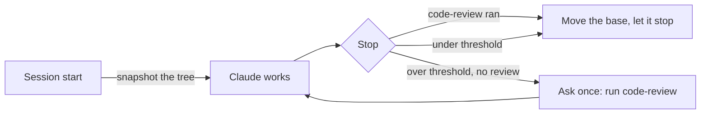

# claude-starter: the details

The [README](../README.md) is the short version. This page keeps the numbers, the evidence and the fine print.

## The numbers

Measured with the Harbor benchmark harness on Claude Code 2.1.312, headless (`claude -p`), with hidden tests. Samples are small; costs are Claude Code's API-equivalent `cost_usd`, not what a subscription bills.

| What we measured | Without | With the starter |
|---|---|---|
| Sonnet 5.5 runs `code-review` in SWE-bench Pro sessions | 4/8, then 0/4 (rule only) | **3/3, then 3/3** of sessions over the threshold (rule + review gate) |
| Opus 5.5 follows the scoped review rule (review when over the threshold, skip when under) | — | **12/12** decisions correct |
| Bugs the post-fan-out review confirmed and fixed, each reproduced and given a regression test | — | **16** across 3 runs (5, 5, 6) |
| Plan conflict found independently by all 3 runs and handed to the user | — | **3/3** |
| Fan-out with Sonnet workers on a 4-part plan of small parts (about 100–150 lines each) | one Opus session: $1.19, 271 s | **$1.89** (Opus main $1.23–1.33 + Sonnet workers $0.61–0.64), 311 s |
| The same plan in one Sonnet session | one Opus session: $1.19 | **$0.46**, 176 s, same 3/3 |
| A large plan (4 parts of 230–300 lines, 77 hidden tests): Opus main session's share of the cost | earlier fan-out: $1.02–1.50 | **$0.11–0.24** with the 0.7 workflow, 3/3 at 77/77 |
| The same large plan, whole run | plain Opus $2.00–3.15 · plain Sonnet **$0.89–1.29** | 0.7 workflow $2.61–3.05 (0.6: $3.02–4.12) |

All three solved the plan 3/3 (44/44 hidden tests). Fan-out with cheap Sonnet workers still cost about **1.6× one Opus session**. The workers wrote most of the code for about $0.62, but the Opus main session's coordination (contract, briefs, reading diffs, merging one part at a time, re-testing, review) read 1.26–1.41M tokens. That is more than the whole single Opus session cost. So from 0.3 to 0.7, fan-out only ran when at least two parts were large, and on this plan it stayed in one session 3/3 times. Since 0.8, parallel workers run only for plans too big for one session, and only with your OK. The cheapest arm was a plain Sonnet session, at about 40% of Opus's cost.

Since 0.6, the coordination itself runs in a workflow of Sonnet agents, so the Opus main session stops paying for it. 0.7 cut the workflow to as few agents as the job allows (a builder and a reviewer; workers and an integrator only for large plans), which took about 20% off 0.6's cost on the large plan. The whole run still costs a little more than a plain Opus session ($2.80 vs $2.41 on average) and about 2.5× a plain Sonnet session. So the workflow buys a nearly empty Opus main context and a fresh review, not lower total spend. **If cost is all you care about, run the plan in a plain Sonnet session.** See [the evidence](#the-evidence).

> **Correction:** the first published fan-out numbers ($2.28–2.50) had **Opus workers by mistake**. The benchmark harness pinned every subagent to the main model, which overrode the workers' `model: sonnet`. The numbers above come from a rerun with Sonnet workers, verified in each worker's transcript.

## What's inside

| Piece | Kind | What it does |
|---|---|---|
| **Working rules** | `SessionStart` hook, about 600 tokens per session | Short rules: ask before assuming, check the docs, route web research, delegate wide searches, suggest fan-out only with your OK, verify before saying done ([read them](plugins/starter/rules.md)) |
| **Review gate** | `Stop` hook, on by default | If the session changed enough code and `code-review` hasn't run, it asks Claude once to run it before stopping |
| **`fan-out`** | Skill (Claude suggests it, you agree) plus the `fan-out-run` workflow | Hands an approved multi-part plan to a workflow that runs outside the main session on its own branch: one Sonnet builder (or, for very large plans and with your OK, parallel Sonnet workers in worktrees and an integrator), then one fresh Sonnet reviewer |
| **`clean-worktrees`** | Skill (you run it) | Removes clean, merged worktrees and branches, and never deletes through links into your main checkout |
| **`setup`** | Skill (you run it) | Sets what a plugin can't ship (worktree base, optional add-ons) and turns the rules or the gate off, showing every change first |
| **`monthly-review`** | Skill plus a reminder when a review is due (at most once a day) | Runs `/insights`, checks its suggestions against your setup, applies at most two, prunes auto memory |

## Quick start

Needs **Node.js 18+** on PATH: the hooks and scripts run with `node`, and Claude Code's native installer doesn't include it. Without Node, the session-start hook shows an error each time.

```bash
claude plugin marketplace add bothuany/claude-starter
claude plugin install starter@claude-starter
```

The rules and the review gate work from the next session; nothing is written to your CLAUDE.md. Optionally, run `/starter:setup` in a session. It shows each change and asks before making it:

- **Old rules block:** versions before 0.8 copied the rules into `~/.claude/CLAUDE.md`. Setup removes that copy (with a timestamped backup); until then the plugin holds its own copy back, so the rules never load twice.
- **`worktree.baseRef: "head"`:** set for the project you fan out in, so parallel workers see the contract commit.
- **Optional add-ons** (all off unless you say yes): context7, obscura, i-have-adhd and ponytail. See [below](#optional-add-ons).
- **The rules and the review gate:** both on by default; turn either off here if you prefer.

New MCP servers show up after a restart.

## Commands

| Command | What it does |
|---|---|
| `/starter:setup` | Show and apply the setup above. `/starter:setup check` only reports the current state |
| `/starter:fan-out <plan file or parts>` | Hand an approved plan to the workflow yourself. For a very large plan it asks, with a cost estimate, whether to use parallel workers |
| `/starter:clean-worktrees` | List worktrees and branches, propose what's safe to remove, ask, then remove it. Add `all-merged` to skip the question, or `--into <branch>` to measure "merged" against another branch |
| `/starter:monthly-review` | Run the monthly review. `off` stops the reminder; `on` brings it back |
| `CLAUDE_STARTER_REVIEW_GATE=off` | Turn the review gate off from settings (`off`, `0`, `false` or `no`) |

To turn the gate off for every session, add this to `~/.claude/settings.json`:

```json
{ "env": { "CLAUDE_STARTER_REVIEW_GATE": "off" } }
```

## How it works

### The rules, in one breath

- **Ask before assuming.** If a request is ambiguous in a way that changes the result, ask, at most 4 questions with a recommended option first. Don't ask what you can look up.
- **Check the docs, not memory.** Look up a third-party API before writing against it (context7, or the official docs), and say which version you checked.
- **Web research.** Use obscura first when it's connected; fall back to WebSearch and WebFetch, and say so.
- **Delegate.** Small fixes (roughly under 30 lines) stay in the main session; larger rewrites and wide reading go to subagents that return conclusions, not file dumps. Independent pieces each get their own writer, in parallel, never on the same file, and a finished piece is reviewed while the others are still being written. In work judged by eye the subagent applies and the main session compares. Suggest fan-out for big approved plans, and start it only when you agree. Read a worker's diff; don't trust its summary.
- **Verify before you say done.** Run the project's tests, type check and lint, and report failures word for word. Send risky changes (network, permissions, stored data) to an independent `code-review` and handle every finding with evidence; a change that only alters how something looks needs the tests and a side-by-side check. Say plainly what wasn't verified.

### Review that runs when it matters, and findings that need evidence

The rules ask for an independent `code-review` of risky code (until 0.9.5: of any change over a size threshold). Opus follows that. Sonnet, in long sessions, often doesn't: once it named "credential handling" as the reason the rule applied, then skipped the review anyway. So a hook also asks, once, when a change crosses a size threshold; when the change isn't risky, Claude says so in one line and stops:



- **When it fires:** 2+ code files with 15+ changed lines in total, or more than 50 changed code lines, since the last review. Committed changes count too.
- **What doesn't count:**
  - tests (`test/`, `tests/`, `__tests__/`, `spec/`, `testdata/`, `fixtures/`, `e2e/`, `*.test.*`, `*.spec.*`, `*_test.*`, `test_*.py`, `conftest.py`, `*Test.java` and similar);
  - docs (`docs/`, `.md`, `.rst`, `.txt` and similar);
  - lockfiles and build output (`package-lock.json`, `*.lock`, `go.sum`, `dist/`, `build/`, `*.min.*`, snapshots);
  - pure renames and whitespace-only changes;
  - anything under `.claude/`.
- **What counts as a review:** Claude calling `code-review`, or you typing `/code-review`. Other review commands, such as `/ponytail-review`, don't.
- **It asks once per change set.** After a review, or a one-line answer such as "docs only" or "not my change", the base moves forward, so follow-up fixes don't trigger another round.
- **It ignores what isn't the session's work:** pulls, merges, resets, checkouts to another commit, turns with no file-changing tool call, and whatever was already in the tree when it first saw the session. Creating a branch doesn't count, so Claude's own work is still asked about after it branches.
- **It costs little and fails silent.** It adds no context unless it blocks, it keeps its own git index and object store and never writes into your `.git`, it skips untracked files over 2MB, and any error lets Claude stop.

Finding a bug isn't enough; acting on it matters. On one SWE-bench Pro task (vuls), all 8 earlier failures broke on the same filename-parsing edge case. Replayed offline, `code-review` named that exact case in **4 of 8** diffs. Under the gate, one run fixed it and passed, the first pass in 9 trials. In the next run, the review named the bug word for word, and the agent dismissed it because "the cases in the task ... parse correctly". Since 0.5.0, every finding gets one of three outcomes (a wording change; its effect isn't measured yet):

- **Confirmed:** reproduce it with a command or a throwaway test, then fix it.
- **Dismissed:** only with evidence, meaning the line you read or a command you ran and its output.
- **Unverified:** only when checking takes more than a few minutes or needs your decision.

"The examples pass" and "it was like that before" don't count as evidence.

### Fan-out, as a workflow

For an approved plan with 3 or more parts, Claude may suggest `/starter:fan-out`; it starts only when you agree, or when you type it. It hands the plan to the plugin's `fan-out-run` [workflow](https://code.claude.com/docs/en/workflows). The main session checks that the tree is clean, creates a `fan-out/<slug>` work branch, starts the workflow, and reads the result. Everything else runs in workflow agents whose models are fixed by design:

| Step | Who | Model |
|---|---|---|
| Build the whole plan with tests; or, with parallel approved, commit the shared contract and write one brief per part | builder | Sonnet (high effort) |
| Parallel only: one worker per part in its own git worktree | workers | Sonnet (effort by part: low, medium, high) |
| Parallel only: merge the branches one at a time with fast checks after each merge (an out-of-list file is a warning it judges; a small failure it fixes; otherwise only that merge is rolled back), run the full checks once, remove merged worktrees with the safe script | integrator | Sonnet |
| `code-review` at high effort on the whole change, then reproduce and fix, dismiss with evidence, or mark needs-decision or not-checked each finding (parts that did not land go to missing, not findings); build the plan table (item, `file:line`, test) | reviewer | Sonnet |

Every workflow agent pays its own start-up (about $0.10–0.25; about 70k tokens of context on a machine with many skills and MCP servers), so most plans run with two agents. Parallel workers are for plans too big for one session: above about 1500 non-test lines, or when the plan clearly won't fit one context. Then Claude asks once, with a cost estimate, before using them. A real 10-part run took about 2.9M tokens and 1 h 50 min, and four of its workers each reached 480–650k tokens of context for one part. Before a parallel run, Claude checks that workers will branch from your HEAD (`worktree.baseRef: "head"`) and offers to fix that for this project. A build whose checks failed, or that committed nothing, isn't reviewed.

Why a workflow: the measured cost of the earlier fan-out was the Opus main session coordinating every brief, diff, merge and re-test, not the workers. In a workflow that coordination runs in Sonnet agents and the main context only holds the final result.

**Headless use:** `claude -p` stops background work after 10 minutes of idle waiting, which kills a long workflow. Set `CLAUDE_CODE_PRINT_BG_WAIT_CEILING_MS` (for example `3000000`, or `0` for no cap).

### Cleanup that never deletes through a link

Worktrees often hold symlinks, or NTFS junctions on Windows, into the main checkout's `node_modules`. Git for Windows deletes through a junction on `git worktree remove --force`. `clean-worktrees` unlinks every link first (the link, never its target), and refuses a worktree that:

- has uncommitted or untracked files;
- has a git status it can't read;
- is detached with commits that no branch holds;
- is locked by a running session, unless you force it;
- holds gitignored files, unless you allow it after seeing the list;
- is in use by another program (checked on Windows);
- is your main checkout.

"Merged" means merged into your local default branch (from `origin/HEAD`, then `main`, then `master`), so unpushed merges count. If none is found, it asks instead of guessing.

## What you'll see at session start

At session start the starter adds only its rules to the context. When something needs you, it shows one line that only you see:

| Notice | Why | What to do |
|---|---|---|
| `the working rules now come from the plugin itself` | An old copy of the rules (before 0.8) is still in your CLAUDE.md | Run `/starter:setup` to remove it |
| `unbalanced claude-starter markers` | An old block's begin or end marker was edited away | Delete the old block by hand; setup won't guess where it ends |
| `monthly review due` | Your newest `/insights` report is 30+ days old, or a memory index passed 150 lines or 20KB | Run `/starter:monthly-review`, or `off` to stop it. It shows at most once a day |

## Optional add-ons

All four are offered by `/starter:setup`, and none is installed without a yes.

| Add-on | What it brings | What it costs |
|---|---|---|
| [**context7**](https://github.com/upstash/context7) | Current library documentation as an MCP server, no key needed | Tool schemas, loaded on demand. Sends library names and topics to context7.com, so check that's allowed on a work machine |
| [**obscura**](https://github.com/h4ckf0r0day/obscura) | A local headless browser for web research, used before WebSearch/WebFetch | Install the binary yourself: the normal build from its releases page, not a `-stealth` build, on PATH. Then run setup |
| [**i-have-adhd**](https://github.com/ayghri/i-have-adhd) | A separate third-party plugin (MIT, pinned to v0.4.1) that shapes answers: next action first, numbered steps, no tangents | A SessionStart hook adds its instructions to every session |
| [**ponytail**](https://github.com/DietrichGebert/ponytail) | A separate third-party plugin (MIT, pinned to v5.3.3), "the laziest senior dev in the room": reuse what the repo has, standard library first, the smallest code that works, never cutting validation, security or tests. Adds `/ponytail-review`, `/ponytail-audit` and a cost band above the prompt | Its instructions load into every session through its own hooks. After each turn it writes a row (cost, tokens, tests) to `~/.config/ponytail/band/` on your machine; nothing leaves unless you set its webhook |

You can install the two third-party plugins directly, too: `claude plugin install i-have-adhd@claude-starter` or `claude plugin install ponytail@claude-starter`. Their claims and numbers are their authors', not measured here.

## The evidence

<details>
<summary><b>Rules vs no rules</b>: Opus 5.5, 4 small Node tasks × 3</summary>

| | No rules | Rules (0.2.0) |
|---|---|---|
| Success | 9/12 | 9/12 |
| `code-review` called | 0/12 | 12/12 |
| Edits made after the review | — | 0/12 |
| Cost per task | $0.13 | $0.25 |
| Agent time | 29 s | 52 s |

All misses came from one task, where both arms fixed the asked bug but missed a second, unasked contract bug. These were ceiling tasks: "no edits after review" doesn't show the review is useless, only that it was costly on small changes. That is why 0.4 scoped the rule. With the scoped rule on the same tasks, Opus made 12/12 correct decisions: 9 reviews and 3 skips.
</details>

<details>
<summary><b>Fan-out vs one session</b>: a 4-part plan of small parts, 44 hidden tests, × 3</summary>

**With Sonnet workers (0.5.1, the intended design):**

| Arm | Success | Cost per trial | Of which | Main-session input | Agent time |
|---|---|---|---|---|---|
| One session, Opus | 3/3 | $1.19 (1.16–1.23) | all Opus | 0.54–0.85M | 271 s |
| Fan-out, Opus main + Sonnet workers | 3/3 | $1.89 (1.84–1.97) | Opus $1.23–1.33, Sonnet $0.61–0.64 | 1.26–1.41M | 311 s |
| One session, Sonnet | 3/3 | $0.46 (0.36–0.58) | all Sonnet | — | 176 s |

The Sonnet session was run as `opusplan`, but headless runs never enter plan mode, so it ran entirely on Sonnet. Interactive `opusplan`, with Opus planning, isn't measured.

**Earlier runs (0.2.0 and 0.4), whose workers ran on Opus by mistake:**

| Arm (0.2.0) | Success | Cost | Agent time | Peak main context | Main-session input |
|---|---|---|---|---|---|
| One session | 3/3 (44/44 tests) | $1.21 | 289 s | 52k | 374k |
| Auto fan-out | 3/3 | $2.50 | 283 s | 62k | 1,207k |
| `/starter:fan-out` | 3/3 | $2.28 | 252 s | 58k | 976k |

Under 0.4, on the same plan:

- **Plain instruction:** it stayed in one session 3/3, at $1.14–1.16.
- **Forced with `/starter:fan-out`:** it fanned out 3/3 with 4 Opus workers, at $2.14–2.66.

The review after that 0.4 merge found 5, 5 and 6 bugs, each reproduced and given a regression test:

- a stack overflow at 200,000 rows;
- semver prerelease numbers above 2^53 comparing equal;
- float rounding at exact halves;
- inherited object properties read as columns.

It dismissed 1–2 per run with evidence, and handed the same spec conflict to the user in all 3 runs. The hidden-test score didn't move, because the hidden tests don't cover those edges.
</details>

<details>
<summary><b>Fan-out as a workflow (0.6, 0.7)</b>: a large plan, 4 parts of 230–300 non-test lines, 77 hidden tests, k = 3</summary>

| Arm | Success | Cost per trial (mean) | Opus main session | Agent time |
|---|---|---|---|---|
| Plain Sonnet session, no plugin | 3/3 at 77/77 | $0.89–1.29 (**$1.11**) | — | 2–5 min |
| Plain Opus session, no plugin | 3/3 at 77/77 | $2.00–3.15 ($2.41) | — | 3–7 min |
| **0.7 workflow** (builder chose fan-out 3/3, Sonnet review) | 3/3 at 77/77 | $2.61–3.05 (**$2.80**) | $0.11–0.24 | 10–12 min |
| 0.6 workflow (planner, workers, integrator, Opus review, Sonnet verifier, Haiku cleanup) | 3/3 at 77/77 | $3.02–4.12 ($3.49) | $0.09–0.26 | 11–16 min |
| Earlier fan-out (Agent tool, merges in the main session) | 3/3 at 77/77 | $3.39–4.03 | $1.02–1.50 | 7–14 min |
| Opus with the rules, no plugin | 3/3 at 77/77 | $2.77–3.26 | $0.83–0.97 | 6–10 min |

- "Plain Opus" isn't always a single session: in some runs Opus spawned subagents of its own, so its main-session share varies.
- Every arm solved the plan, so these runs compare cost, not quality. The hidden tests don't cover the edge cases the review fixes.
- 0.6.0 had a parse error in the workflow script (fixed in 0.6.1). A first round was cut off by `claude -p`'s 10-minute background wait. Several rounds hit the subscription usage limit. None of those runs are counted.

On the small plan (4 parts of about 100–150 lines, 44 hidden tests), the builder chose one session 3/3: 3/3 correct at $0.88–1.58 (mean $1.32), against $1.76 for 0.6, $1.19 for plain Opus and $0.46 for plain Sonnet.
</details>

<details>
<summary><b>Review gate</b>: Sonnet 5.5 on SWE-bench Pro (vuls, teleport, element-web, openlibrary), k = 1</summary>

| Run | Review ran when over the threshold | Solved | Cost (4 tasks) |
|---|---|---|---|
| Baseline, no starter | — | 1/4, 2/4 | $0.72, $0.82 |
| Rules (± plugin), no gate | 4/8, 0/4 | 1/4 per arm | $0.87–0.96 (first round) |
| Gate, first run | 3/3 | 3/4 | $1.12 |
| Gate, after fixes | 3/3 | 2/4 | $1.13 |

The gate reliably gets the review to run, at about +29% cost ($1.12 vs $0.87). With k = 1, the solved column is noise: the baseline alone moved from 1/4 to 2/4. Don't read it as a success-rate gain. openlibrary stayed under the threshold, so the gate never blocked there. On Opus small tasks the gate never had to fire, and no review ran twice.
</details>

### Not measured yet

- **Ask-first behaviour interactively.** Headless runs can't ask. In one manual check, with the rules Claude asked 2 questions before coding; without them it coded at once.
- **Interactive `opusplan`** (Opus plans, Sonnet executes). Headless runs only measured plain Sonnet.
- **Sonnet review vs Opus review, finding by finding.** 0.7 reviews with Sonnet because it costs less; whether Opus finds more on the same change wasn't compared.
- **A plan where the parts are too big for one session's context**, the case fan-out is meant for. Both benchmark plans fit in one Sonnet session.
- **The 0.5.0 evidence rule's effect** on acting on findings.
- **The review's catch rate** on seeded defects, and `low` vs `medium`.

## Context cost

| | Tokens in every session |
|---|---|
| Rules, injected at session start | about 600 |
| What Claude sees of the plugin (the `fan-out` description) | about 150 |
| Other hooks (session check, review gate) | 0, until the gate blocks |
| `setup`, `clean-worktrees`, `monthly-review` | 0 (user-only skills) |

`claude plugin details starter` doesn't count the hook-injected rules, and it does count the three user-only skills, whose descriptions don't load. Add-ons bring their own: context7's tool schemas load on demand, and i-have-adhd and ponytail add their instructions to every session.

## Design choices

- **Few pieces, each one earning its place.** There are four role agents (`locator`, `reader`, `writer`, `reviewer`), because a role pins model and effort and the type of a task is readable from its brief. There are still no generic "senior engineer" personas: they add context at every session and little behaviour.
- **Rules from the plugin, hooks only where rules fail.** The rules arrive with the plugin and leave with it, and their cost is fixed. The review gate exists because one model skipped the rule; nothing else is forced.
- **Questions come from the main session.** Subagents can't ask you, so open questions are settled before delegating.
- **Parallel only when it pays.** Coding parallelizes less than research. On a small plan, fan-out with Sonnet workers cost 1.6× one Opus session, so the workflow's builder does most plans itself in one Sonnet session, and parallel workers need your OK. The 1500-line mark is a guess.
- **Coordination in a workflow, not in the main session.** The cost of the old fan-out was the Opus main session merging and re-testing. A script now holds that loop with as few agents as the job allows, each with a fixed model: Sonnet builds and reviews, and the main session only reads the result.

## Limits to know

- **Rules are probabilistic.** That's why the review has a hook. For any other rule you need guaranteed, use a hook in that project.
- **Claude's own merges count as outside changes.** A merge, pull, reset or rebase moves the gate's base even when Claude ran it. Fan-out reviews its own merges anyway.
- **Gate cost on big repos.** Each check runs `git add -A` into a private index and object store, skipping untracked files over 2MB, so many untracked files or Git LFS clean filters still slow it down. Turn it off with `/starter:setup` or the env setting above.
- **Worker dependencies.** A worktree is a fresh checkout. Before starting the workflow, Claude decides how workers get dependencies: `.worktreeinclude`, `worktree.symlinkDirectories`, a cheap install, or checks that need none.
- **Workflows and `claude -p`.** Headless runs stop background work after 10 minutes of idle waiting by default. Set `CLAUDE_CODE_PRINT_BG_WAIT_CEILING_MS` for long plans.
- **`worktree.baseRef: "head"`** also makes `claude --worktree` sessions start from your current HEAD. That's why setup sets it per project.

## Keep it sharp: the monthly review

The starter never writes skills or memories on its own: tools that do tend to pile up near-duplicates. Instead, `/starter:monthly-review`:

1. **Gets an `/insights` report.** It reuses one from the last 7 days. Otherwise it runs a new one, which took about a minute and about $1.50 for 130 sessions in our runs. If that fails, it asks you to run `/insights` yourself.
2. **Checks every suggestion** against the skills, hooks and CLAUDE.md files you already have. Each one is already covered, wrong for your setup, or worth doing.
3. **Applies at most two,** after you choose, so you can tell whether each one helped. A CLAUDE.md line goes where it's needed, a skill goes through `skill-creator` with a before-and-after eval, and a hook goes into the project.
4. **Prunes auto memory.** It proposes removing what's stale, duplicated or derivable from the code, and asks before deleting anything.

Claude Code deletes `/insights` reports after `cleanupPeriodDays` (30 by default), so "no recent report" is normal. Raise that setting if you want reviews to reach further back.

## FAQ

**Will it slow me down?**
Small changes: no. Below the threshold the review isn't asked for, and apart from the rules the hooks add no context. Larger changes get one review, which cost about +29% on our SWE runs.

**Can I use only part of it?**
Yes. Turn the rules or the gate off in setup, or never type the commands. Each piece works on its own.

**Does it work with Sonnet?**
Yes. That's why the gate exists: Opus followed the review rule on its own, while Sonnet needed the nudge.

**Why does fan-out so rarely run in parallel?**
Because on a small plan, parallel workers cost 1.6× one Opus session for the same result. The workflow's builder does most plans itself in one Sonnet session; parallel workers run only for plans too big for one context, and only after you approve the estimated cost.

**Isn't Opus planning plus Sonnet workers cheaper than all-Opus?**
Not when the Opus main session does the coordinating: $1.89 vs $1.19 on the small plan. That's why 0.6 moved coordination into a workflow: on the large plan the Opus main session's share fell to $0.11–0.24. In total, the 0.7 workflow still ran a little above plain Opus ($2.80 vs $2.41 on average), because every agent's start-up and the review add up. If cost is what you're after, a plain Sonnet session solved both plans 3/3: $0.46 for the small one, $1.11 for the large one.

## Privacy

- The starter itself collects nothing and sends nothing.
- context7, if you add it, sends library names and topics to [context7.com](https://context7.com).
- ponytail, if you add it, keeps its task log on your machine unless you set its webhook.
- obscura runs locally.

## Uninstall

```bash
claude plugin uninstall starter@claude-starter
```

Then undo what setup wrote, if you want it gone. If you use `CLAUDE_CONFIG_DIR`, read that folder for `~/.claude` below.

- If you used a version before 0.8 and never ran setup since, delete the block between `claude-starter:begin` and `claude-starter:end` in `~/.claude/CLAUDE.md`.
- Remove `worktree.baseRef` from the project's `.claude/settings.local.json` or from `~/.claude/settings.json`.
- If setup added them, run `claude mcp remove --scope user obscura` and `claude mcp remove --scope user context7`.
- If you added them, run `claude plugin uninstall i-have-adhd@claude-starter` and `claude plugin uninstall ponytail@claude-starter`.
- Delete the `*.starter-backup` files.

## Tests

```bash
node --test test/scripts.test.mjs test/workflow.test.mjs
```

The first runs every script against throwaway repositories and config directories; it never touches your own `~/.claude`. The second runs the fan-out workflow's control flow with stub agents.

## Pairs well with

- [`feature-dev`](https://github.com/anthropics/claude-plugins-official): a guided explore → clarify → architect → build → review flow for larger features.
- [superpowers](https://github.com/obra/superpowers): a much more prescriptive workflow. "Verify before claiming done" comes from it.

## License

MIT
