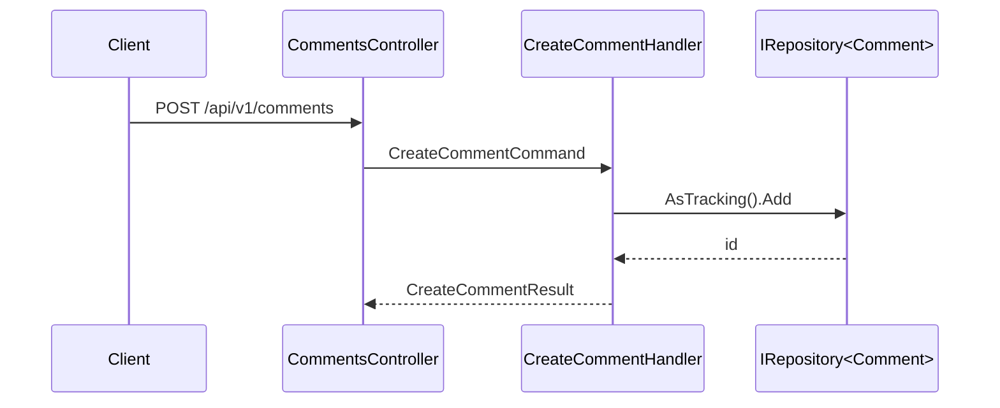

# The block schema

This is the contract both `visual-plan` and `visual-recap` render. Same blocks, same column
names, same order — that is what makes a plan and a recap comparable, and drift detectable.

Every block below that applies to the change **must appear**. Omit a block only with a one-line
reason (`Data Model — bu değişiklik şemaya dokunmuyor`). An applicable block whose answer you
don't know still appears, with `❓ BİLİNMİYOR` in the unknown cell and a numbered row in Open
Questions. Guessing is the one failure mode this schema exists to prevent.

---

## 1. Özet / Summary

Three sentences maximum: what changes, for whom, and the one design decision that drove the
rest. If you cannot say it in three sentences you do not understand the change yet.

Directly under it, a one-line **verdict row** the reviewer can read alone:

> **Dokunulan:** 6 dosya · 2 endpoint · 1 tablo · 0 migration · risk: orta

## 2. API Kontratı / API Contract

One table per endpoint touched. Never a bullet list.

| Alan | Değer |
|---|---|
| Method + Path | `POST /api/v1/comments` |
| Auth | bearer, `Comment.Write` claim — **anonim erişim yok** |
| Request | tam şema (aşağıdaki alan tablosu) |
| Response 2xx | tam şema + HTTP kodu |
| Hata kodları | 400 / 401 / 403 / 404 / 409 ve her birinin tetikleyicisi |
| Idempotent? | evet/hayır + neden |
| Sayfalama | var/yok; varsa parametre adları ve varsayılan sayfa boyutu |

Then, per request and per response, a field table:

| Alan | Tip | Zorunlu | Varsayılan | Not |
|---|---|---|---|---|
| `postId` | `long` | ✔ | — | var olan post olmalı, yoksa 404 |
| `parentId` | `long?` | — | `null` | thread yanıtı; kendi kendine referans yasak |

Rules:
- Auth is **never** blank and never "standard auth". Name the scheme and the claim/role.
- Every error code needs its trigger. "400 on invalid input" is not a trigger.
- If a field is nullable in the DB but non-nullable in the contract (or vice versa), say so
  here — that mismatch is the single most common bug this table catches.

## 3. Veri Modeli / Data Model

One table per DB table touched, with the repo's real naming (prefixes included).

| Kolon | Tip | Null | Varsayılan | Index / FK |
|---|---|---|---|---|
| `ID` | `NUMBER(19)` | ✖ | sequence | PK |
| `POST_ID` | `NUMBER(19)` | ✖ | — | FK → `POSTS.ID`, index |
| `STATUS` | `VARCHAR2(20)` | ✖ | `'PENDING'` | — |

Plus, per table: **new / altered / read-only**, whether a migration is required, whether the
change is backward compatible with the currently deployed code, and — for altered tables —
what happens to existing rows.

Relations that matter go in a mermaid `erDiagram`. Skip the ER diagram for a single table.

## 4. Akış / Flow

A mermaid diagram of the request path through the repo's real layers, with the actual type
names — not `Service` and `Repository` in the abstract.

For branching logic (permission checks, fallbacks, cache hits) use a `flowchart` instead and
show the failure edges, not just the happy path.

## 5. Mevcut Kod Envanteri / Existing Code Inventory

Before the File Map, answer the question the File Map cannot: **how much of this is already
written?** A plan that lists 70 new files in a codebase that already solves half the problem is
not a plan, it is a proposal to fork.

| Mevcut kod | Bugün ne yapıyor | Bu planda karşılığı | Karar |
|---|---|---|---|
| `Qr/AutoEnrollmentWriter` | attendee + schedule + computation yazımı | F3'ün 5 tablo yazması | ortak servise çıkar |
| `TrainingCancellationService` | KÜP iptali (`EGITIM_IPTAL`) | — | **karıştırma** — farklı akış |

Three things make this block work, and all three are easy to skip:

**Search by write surface, not by name.** The code you need is routinely filed under a feature
you are not building. List the tables, entities and DbSets your change touches, then grep for
*those* names — `TrainingClassAttendee`, `LMS_SCHEDULE_EMPLOYEE` — rather than for what your
feature is called. Searching for "attendee service" finds nothing when the implementation lives
in `Services/Implementations/Qr/AutoEnrollmentWriter.cs`; searching for what it writes finds it
immediately. Also sweep the service/interface directory listing by eye once: names lie, folders
lie, but a 60-line listing read end to end does not.

**Name the near-misses too.** A service that looks applicable and is not is worth a row, because
the next reader will find it and wonder. Say what it actually does and why it is the wrong tool
(`TrainingCancellationService` cancels library enrolments, not selections — different table
semantics). An inventory of only the hits invites the same mistake from the other direction.

**Say what changes about the existing code.** "Reuse `X`" is not a decision until you have said
whether X is used as is, extended with a parameter, or extracted to a shared place — and what
the existing caller does about it. An extraction that silently changes behaviour for the current
caller is a regression, so it belongs in Risks.

Then reconcile: **every row of the File Map marked *yeni* must survive this inventory.** If a new
file does work that an existing service already does, either the row becomes a change to that
service or the inventory gains a line saying why a second implementation is correct.

An empty inventory on a non-trivial change is a smell, not an achievement — in a mature codebase
it almost always means the search was done by feature name. Say explicitly when you searched and
there genuinely is nothing.

On a **revision**, this block does not carry forward. If the plan gained a flow or a phase since
the last version, the inventory covers only the old scope, and a block that is present but stale
is worse than a missing one — it passes review. Re-search for whatever was added and mark the new
rows so the reviewer can see the block kept up with the plan.

## 6. Dosya Haritası / File Map

| Dosya | İşlem | Neden |
|---|---|---|
| `src/Api/Controllers/CommentsController.cs` | değişir | yeni action |
| `src/Business/Comments/CreateCommentHandler.cs` | yeni | komut işleyici |

Rules: real paths, verified to exist (or explicitly marked *yeni*). "Neden" is one clause, not
a restatement of the filename. If the list is longer than ~15 rows, group by layer and say the
count per group — a 40-row file map is a wall of text again.

## 7. Açık Sorular / Open Questions

Numbered. Each row: the question, why it blocks, and your recommended default if the user
doesn't answer.

| # | Soru | Neden bloke ediyor | Önerim |
|---|---|---|---|
| 1 | Silinen yorum soft-delete mi hard-delete mi? | şema ve sorgu filtresi buna bağlı | soft-delete |

An empty Open Questions block on a non-trivial change is a smell, not an achievement — it
usually means assumptions were made silently. Say explicitly when there genuinely are none.

## 8. Riskler / Risks

| Risk | Etki | Azaltma |
|---|---|---|

Include repo-specific traps you actually know about (tracking/no-tracking defaults, stale
build behavior, environment-shared volumes, N+1 on a hot path, index that won't be used).
Generic risks ("bug olabilir") are noise — drop them.

## 9. Kapsam Dışı / Out of Scope

A short explicit list of things a reader might reasonably expect and that this change will
**not** do. This block is what makes drift detectable later: anything the implementation did
that is listed here is unplanned work, full stop.

## 10. Doğrulama / Verification

How the reviewer confirms it works — the specific command, endpoint call, or test name. Not
"tests will be added".
